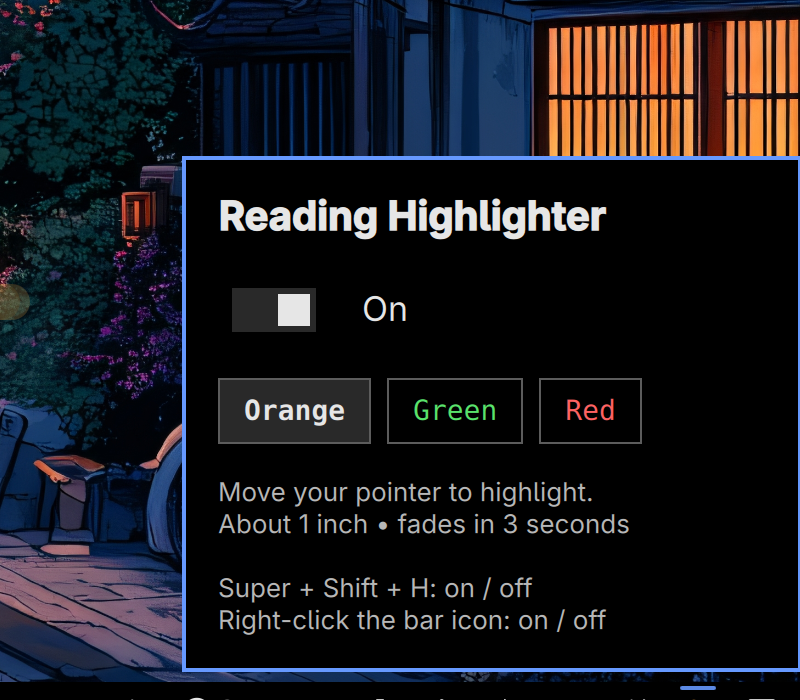

# Reading Highlighter for Omarchy

Follow text with a fading marker trail, or hold a key while tracing words to save
editable text to your notes. Works across desktop applications without selecting
or changing the original document.



*The preview shows the original trail controls. Version 2.1 adds capture and notes settings.*

## Features

- Orange, green, or red translucent ink, with a roughly one-inch tail that fades
  over three seconds. Mouse clicks pass through the overlay.
- Hold **Left Ctrl** while the trail is on to capture the words you trace. Release
  Ctrl to append recognized text to a notes file with a timestamp.
- Choose a destination folder, a `.md` or `.txt` file, and an installed text editor.
- Optionally open the chosen app after each capture.
- Open the current notes file or reveal it in the file manager with shortcuts
  that act only while the trail is on.
- Local OCR: no network service, account, clipboard replacement, or saved screenshot.

## Requirements

This is an Omarchy shell plugin for Hyprland on Wayland, using Omarchy's bundled
`qs.Commons`, `qs.Ui`, and `Commons.Translations` components. It requires Python 3,
Quickshell, and a recent Omarchy shell. The suggested hold shortcuts require
Omarchy's `o.bind_hold` helper. Check that helper exists in your Omarchy version
before adding the hold bindings; the bar controls work without shortcut setup.

For capture, install these Arch packages if they are missing:

```bash
omarchy pkg add grim tesseract tesseract-data-eng python-pillow python-gobject
```

No pip installation is needed. `python-gobject` provides Gio for installed-app
selection and opening files. `python-pillow` processes the in-memory screenshot.
English OCR is the default; install the appropriate Tesseract language data and
set `OMARCHY_OCR_LANGS` in the shell session environment to use other languages.

The release was tested on Hyprland 0.56.2, Quickshell 0.3.2, Python 3.14.8, and an
Omarchy development build with the above components, using a 2880×1800 display at
2× scaling. Rotation and monitor-coordinate handling are implemented; physical
multiple-monitor capture has not been tested. Keep each capture on one monitor.

## Install

Review this repository, then install and enable the plugin:

```bash
omarchy plugin add https://github.com/techguy-top/omarchy-reading-highlighter --enable
```

The marker appears in the right bar section by default. Click it to open the
panel, or right-click it to toggle the trail. To move it:

```bash
omarchy bar move diky.reading-highlighter --section right
```

The plugin does not install dependencies, add shortcuts, or edit unrelated
configuration automatically.

### Install from a ZIP

Extract a release ZIP. From the folder containing `manifest.json`, run:

```bash
plugin_dest="$HOME/.config/omarchy/plugins/diky.reading-highlighter"
if [ -e "$plugin_dest" ]; then
  printf '%s\n' 'Plugin already exists; keep or back up that installation first.'
else
  mkdir -p "$HOME/.config/omarchy/plugins"
  cp -R . "$plugin_dest"
  omarchy-shell shell rescanPlugins
  omarchy plugin enable diky.reading-highlighter
fi
```

## Update from an earlier release

For a Git-managed installation:

```bash
omarchy plugin update diky.reading-highlighter
```

Install the capture dependencies above and add whichever optional shortcuts you
want below. Existing trail-toggle shortcuts continue to work. Restart the shell
when updating from version 1 because its QML singleton may remain cached:

```bash
omarchy restart shell
```

For a manually installed ZIP, back up the plugin directory and replace its files
with the new release before rescanning and restarting. Notes and settings are
stored outside the plugin directory and are not overwritten by this update.

## Optional shortcuts

First check `omarchy menu keybindings --print` for conflicts. The combinations
below are suggestions, not automatically installed bindings. Add only the ones
you want to `~/.config/hypr/bindings.lua`, choosing different keys if needed:

```lua
-- Toggle the original reading trail.
o.bind("SUPER + SHIFT + H", "Reading highlighter on/off", "omarchy-shell reading-highlighter toggle")

-- Hold Left Ctrl to capture only while the reading trail is on.
o.bind_hold("Control_L", "Hold Left Ctrl to capture reading text", "omarchy-shell reading-highlighter captureHoldStart",
  "Save reading text on Left Ctrl release", "omarchy-shell reading-highlighter captureHoldStop",
  { ignore_mods = true, non_consuming = true })

-- Optional alternate capture, also available with the trail off.
o.bind_hold("SUPER + ALT + H", "Trace words to reading notes", "omarchy-shell reading-highlighter captureStart",
  "Save traced reading text", "omarchy-shell reading-highlighter captureStop")

-- These two actions do nothing while the reading trail is off.
o.bind("SUPER + ALT + N", "Open current reading notes", "omarchy-shell reading-highlighter openNotesIfActive")
o.bind("SUPER + ALT + O", "Open current reading notes folder", "omarchy-shell reading-highlighter openFolderIfActive")
```

Apply and check:

```bash
hyprctl reload
hyprctl configerrors
```

Super is usually the Windows-logo key. With the trail on, Left Ctrl is also a
capture control. Its events still pass to applications, so turn the trail off
for ordinary Ctrl shortcuts if you will move the pointer. A quick Ctrl tap
without tracing cancels without saving. The panel displays the suggested keys;
if you choose different bindings, use those keys instead.

## Capture words to notes

1. Turn on the trail with the panel, right-click, or **Super+Shift+H**.
2. Hold **Left Ctrl** and move through the middle of the words you want. Do not
   press a mouse button. The marker remains visible until you release the key.
3. Release **Ctrl**. OCR reads the words touched by the path and appends them to
   your notes in reading order. You do not need to save manually in the editor.

Alternatively hold **Super+Alt+H**, trace, and release **H**, even with the trail
switch off. A capture ends after two minutes or 4,000 sampled points. Empty
traces and failed OCR do not create an entry. Errors and the last captured text
appear in the panel.

A snapshot is taken at the start. Keep the page still: scrolling or moving
windows during a trace does not update the snapshot. Captures stay on the
monitor where they began. OCR may make mistakes, particularly with small or
stylized text. The plugin does not add permanent highlights to the source app.

## Choose the folder and notes app

The default file is `~/Documents/Reading Highlights.md`. It is created on the
first successful capture. Each capture appends a timestamp and recognized text;
existing content is retained.

- **Choose folder…** applies a folder choice immediately and uses
  `Reading Highlights.md` in that folder.
- You can type a folder path or filename into **Save notes to**, then click
  **Save settings**. A filename without an extension gets `.md`; relative names
  go in `~/Documents`.
- **Currently saving to** always displays the saved destination. Changing it
  affects future captures; earlier notes remain in their original file.
- Pick an installed text-file app, optionally enable **Open app after each
  capture**, and click **Save settings**. Apps that cannot open local text files
  are not listed. Arbitrary shell commands are not accepted as app settings.
- **Open notes** opens the saved file. **Open folder** asks the file manager to
  reveal it, falling back to opening its parent folder.

The panel buttons work with the trail off. The suggested **Super+Alt+N** and
**Super+Alt+O** shortcuts act only while the trail is on.

Settings live in `~/.config/reading-highlighter/settings.json` (or the equivalent
under `XDG_CONFIG_HOME`). Notes live at the chosen destination. An editor that
keeps an already-open document in memory may need to reload it after another
application appends text; the notes file on disk is the saved capture destination.

## Runtime behavior and privacy

`pointer.py` reads cursor coordinates through the user's local Hyprland IPC
socket at 30 Hz only while the trail or capture is active, and refreshes monitor
geometry every three seconds. The trail is 18 logical pixels wide and 34% opaque,
with an approximately one-physical-inch maximum length and three-second fade.
Turning it off stops trail polling unless a separate capture is active. Color
and trail state reset when the shell restarts.

`capture.py` is a local helper with a JSON-lines interface. Only explicit capture
actions take a monitor screenshot through `grim`. Pillow crops the image around
the trace and Tesseract recognizes words. The path selects touched word boxes,
rather than all text in its bounding rectangle. The screenshot exists in memory
until processing finishes or the capture is cancelled; it is not saved to disk.
Cursor positions are not logged, and no network requests are made.

The plugin writes its own settings file and the user-selected notes file. It
uses installed desktop-file handlers to open notes and the file manager. It
requires no administrator access at runtime. Plugins run unsandboxed inside
`omarchy-shell`; review the source and these capabilities before enabling it.
The overlay does not intercept mouse input and stays below the lock screen.

## Runtime commands

```bash
omarchy-shell reading-highlighter toggle
omarchy-shell reading-highlighter off
omarchy-shell reading-highlighter color Green
omarchy-shell reading-highlighter captureHoldStart
omarchy-shell reading-highlighter captureHoldStop
omarchy-shell reading-highlighter captureStart
omarchy-shell reading-highlighter captureStop
omarchy-shell reading-highlighter captureCancel
omarchy-shell reading-highlighter openNotesIfActive
omarchy-shell reading-highlighter openFolderIfActive
omarchy-shell reading-highlighter openNotes
omarchy-shell reading-highlighter openFolder
omarchy-shell reading-highlighter status
```

Colors are `Orange`, `Green`, and `Red`. `openNotesIfActive` and
`openFolderIfActive` return false while the trail is off. The plain `openNotes`
and `openFolder` commands are available regardless of trail state.

## Remove

```bash
omarchy-shell reading-highlighter off
omarchy plugin remove diky.reading-highlighter
```

Remove only the optional Reading Highlighter lines you added to
`~/.config/hypr/bindings.lua`, then run `hyprctl reload` and
`hyprctl configerrors`. Restart with `omarchy restart shell` if its singleton
remains cached. Your notes and `~/.config/reading-highlighter/settings.json`
remain in place; delete them separately only if you no longer want them.

## Development and validation

```bash
omarchy plugin validate .
python3 -m unittest discover -s . -v
```

The eight tests exercise OCR, trace-based word filtering, timestamped appending,
settings persistence, destination normalization, and plain-text handling. Tests
also require `node` and `fc-match` (Fontconfig), plus an installed readable font.
After changing singleton code, use `omarchy restart shell`. Live validation for
this release also covered capture start/cancel, trail toggling, active-state
gating, shortcut registration, and local screen OCR with a temporary output file.

## License

MIT. See [LICENSE](LICENSE). Release changes are listed in [CHANGELOG.md](CHANGELOG.md).
